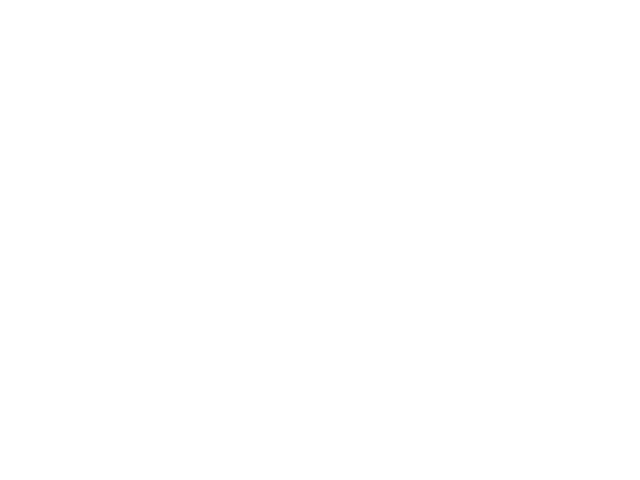
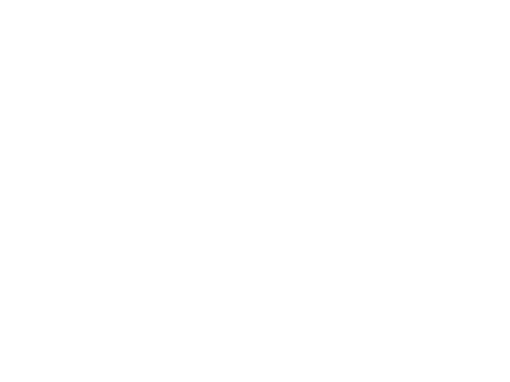
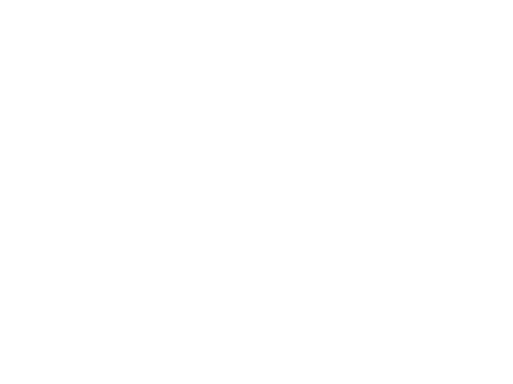

# Monte Carlo Option Pricer

A Monte Carlo pricer for European call options, written in C++ and checked against the Black-Scholes formula, with the simulations visualized in Python. I built it to learn how options are priced by simulating many possible futures for a stock and averaging the payoffs, and to practice proving that a simulation is actually correct.

## How it works

A call option pays $\max(S_T - K,\ 0)$ at expiry, where $S_T$ is the stock price at time $T$ and $K$ is the strike. To price it:

1. Simulate many possible final stock prices using geometric Brownian motion:

   $$S_T = S_0 \, e^{\left(r - \frac{\sigma^2}{2}\right)T + \sigma\sqrt{T}\,Z}, \qquad Z \sim \mathcal{N}(0, 1)$$

2. Compute the call payoff for each one.
3. Average the payoffs and discount back to today: $C \approx e^{-rT} \cdot \overline{\text{payoff}}$.

The program also computes the exact Black-Scholes price and the **standard error** of the Monte Carlo estimate, so it reports how far off it is in units of its own expected noise.

Parameters: $S_0 = 100$, $K = 100$, $r = 0.05$, $\sigma = 0.2$, $T = 1$ year.

## How to run

```bash
clang++ -std=c++17 -O2 -o pricer pricer.cpp && ./pricer
python plot_paths.py
python plot_hist.py
python plot_convergence.py
```

## Results

### Pricing accuracy

| | Price |
|---|---|
| Black-Scholes (exact) | 10.4506 |
| Monte Carlo (100,000 simulations) | 10.4741 |
| Difference | 0.0235 (0.50 standard errors) |

A correct pricer should land within about ±2 standard errors of the exact answer almost every time. This one is at 0.50.

### Simulated price paths



Fifty simulated paths over one year of trading days. The spread widens over time (more time means more uncertainty), and it's lopsided: the best path gains about 65%, while the worst loses only about 28%. In this model prices move in percentages, so they can rise without limit but never fall below zero.

### Distribution of final prices



100,000 final prices form a **lognormal** distribution: a peak near 100 with a long right tail. The call pays off only to the right of the strike. Black-Scholes says the probability of finishing above the strike is $N(d_2)$:

| | Probability $S_T > K$ |
|---|---|
| Black-Scholes, $N(d_2)$ | 0.55962 |
| Simulation | 0.55972 |

### Convergence



| N | Price | Standard error | Error (in SEs) |
|---|---|---|---|
| 1,000 | 11.4193 | 0.5030 | 1.93 |
| 4,000 | 10.5269 | 0.2332 | 0.33 |
| 16,000 | 10.4077 | 0.1156 | −0.37 |
| 64,000 | 10.4796 | 0.0585 | 0.50 |
| 256,000 | 10.4610 | 0.0291 | 0.36 |
| 1,024,000 | 10.4554 | 0.0146 | 0.33 |

Theory says the standard error shrinks like $1/\sqrt{N}$, so each 4× increase in simulations should halve it, and on a log-log plot the points should fall on a line with slope $-\tfrac{1}{2}$. The fitted slope is **−0.508**. All six errors are within ±2 standard errors and show no trend as $N$ grows, so the pricer has no bias: its error is pure noise that shrinks with more simulations.

## Next steps

- Put options, checked with put-call parity
- Option price vs. stock price (Monte Carlo vs. the Black-Scholes curve)
- Greeks, starting with delta